# expendio_dolores

- Arteaga Cruz Luis Manuel
- Pérez Hernádez José Mauricio

# Expendio Dolores

## 1. Descripción breve
Prototipo Flutter para simular la compra y gestión de pedidos de un expendio de productos Bimbo. Los datos se mantienen en memoria solo durante la ejecución.

## 2. Tipos de usuario y dashboards
- **Administrador:** resumen, usuarios, productos y pedidos.
- **Cliente:** catálogo, carrito, pedidos y perfil.
- **Personal del expendio:** panel y actualización de pedidos.
- **Repartidor:** entregas asignadas, registro de resultado e historial.

Contraseña para todas las cuentas demo: `123456`.
- Cliente: `cliente@expendiodolores.mx` (Mauricio Pérez)
- Personal: `personal@expendiodolores.mx` (Luis Manuel Arteaga Cruz)
- Repartidor: `repartidor@expendiodolores.mx` (Alfonso Alderete)
- Administrador: `admin@expendiodolores.mx` (Mau Pérez)

## 3. Manejo de estado elegido
Centralizado en el singleton. El estado se conserva al navegar y al cambiar de perfil mientras la app permanece abierta. El carrito se limpia al cerrar sesión para evitar mezclar compras; los pedidos siguen disponibles para los otros perfiles. Al cerrar completamente la app se pierde todo, porque no hay persistencia ni base de datos.

## 4. Cómo ejecutar la app
Requisitos: Flutter SDK y emulador o dispositivo físico.
```bash
flutter pub get
flutter run
```
El splash screen se muestra durante cinco segundos antes del login.

## 5. Demostración al docente
- Dispositivo/emulador usado: [Android/iOS · modelo y versión]
- Fecha y modalidad: [fecha · presencial/videollamada]
- Flujo sugerido: splash → login → dashboard → lista → formulario/carrito → confirmar pedido → cerrar sesión → iniciar como personal → actualizar estado → iniciar como repartidor → registrar entrega.

## 6. Screenshots
Crea la carpeta `screenshots/` y guarda capturas tomadas con la app corriendo. Las imágenes no se generan automáticamente.

### Splashscreen
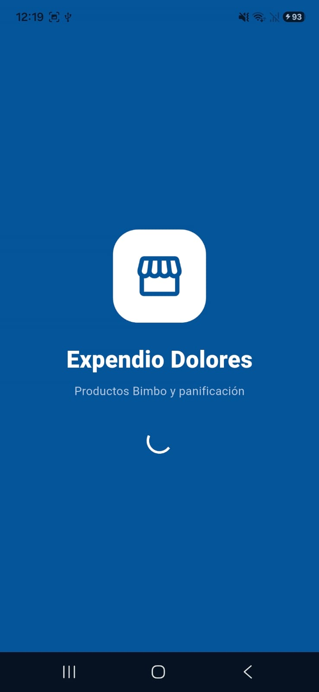
### Autenticación
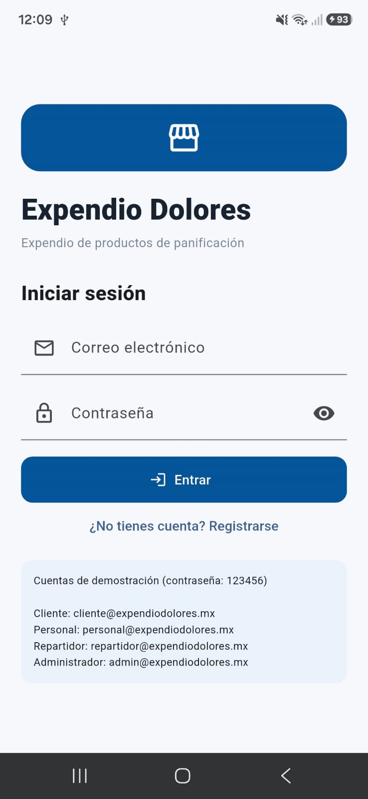
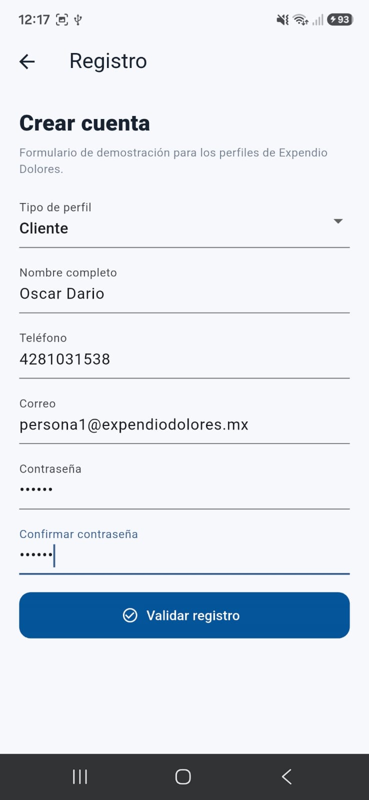
### Dashboards
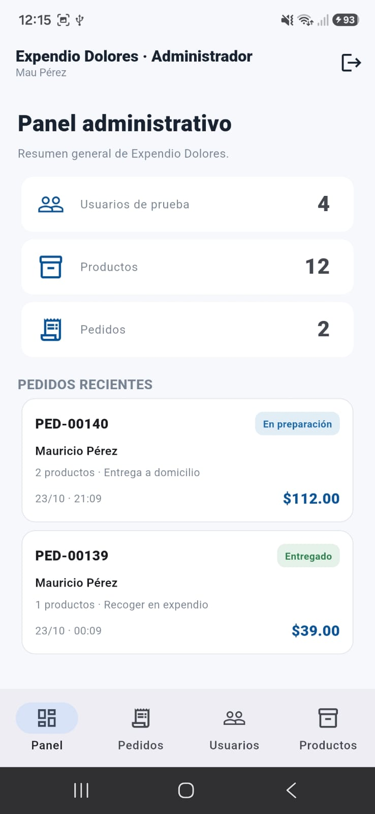
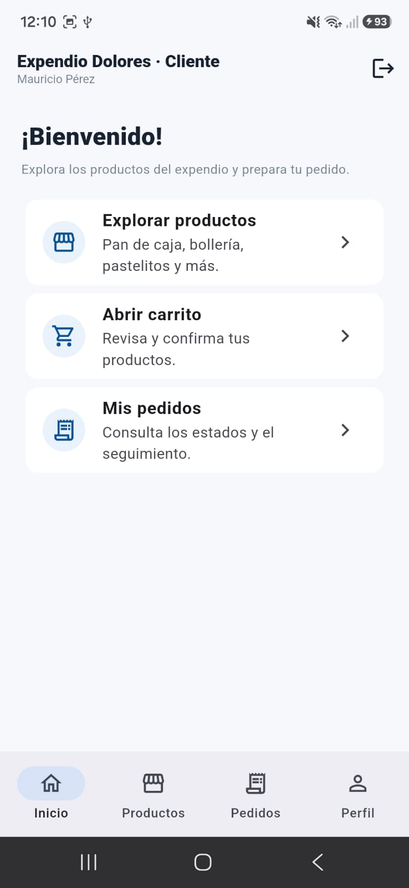
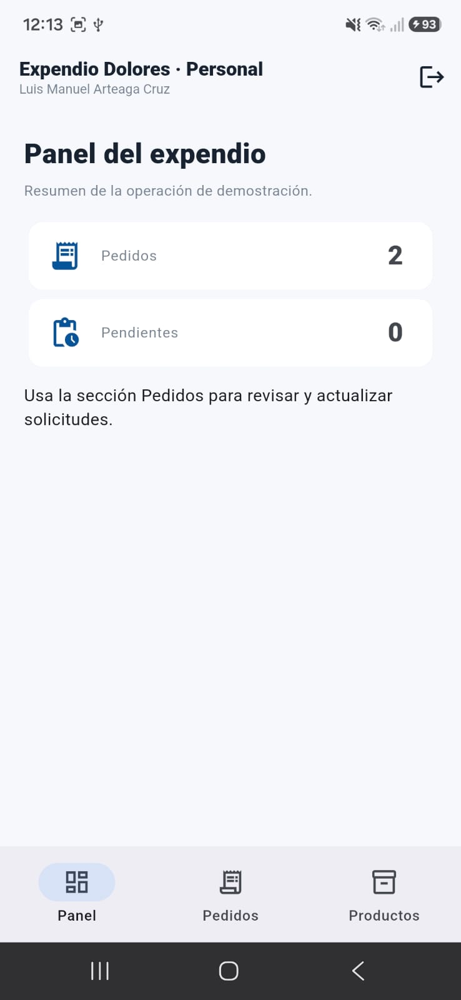
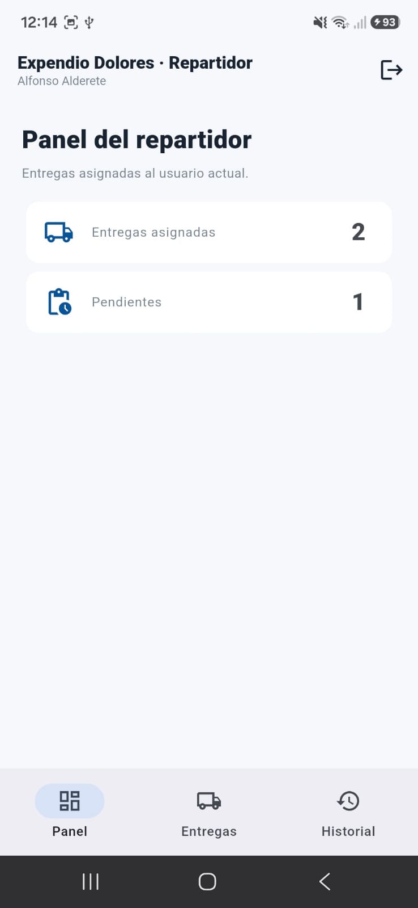
### Listas
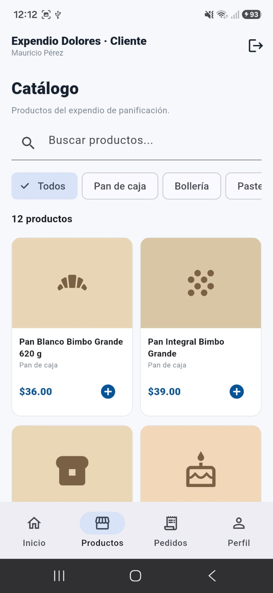
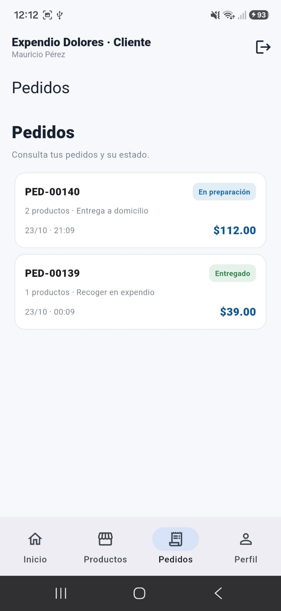
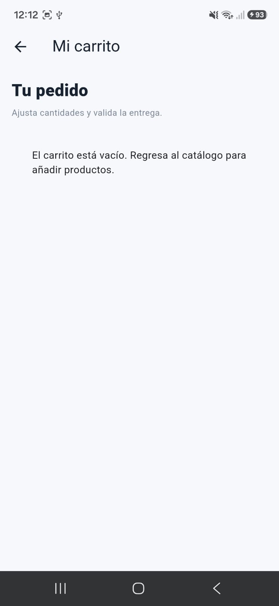
### Formularios
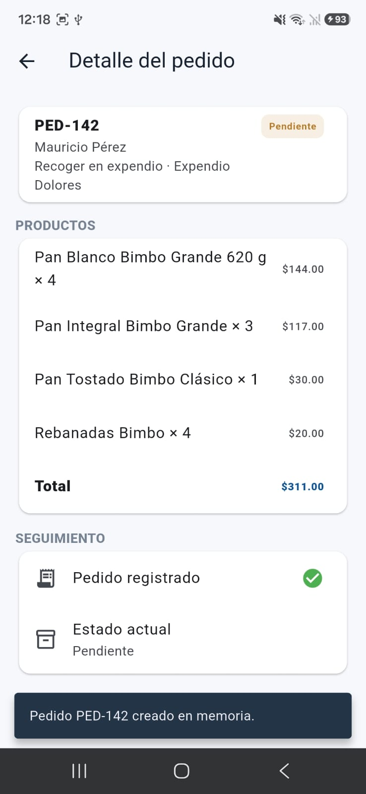
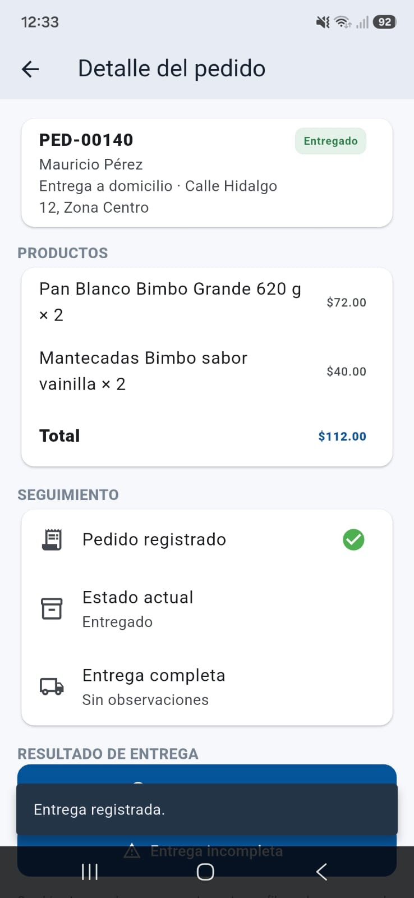
### Evidencia funcional
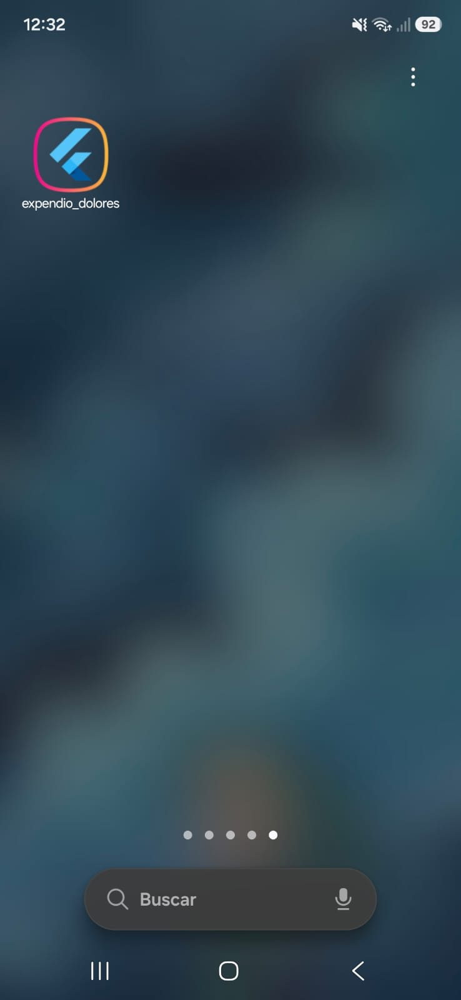


## Alcance
El registro valida datos, pero no crea cuentas persistentes. Los pedidos y cambios son temporales. No hay pagos, GPS ni notificaciones reales; los productos usan iconos ilustrativos en lugar de fotografías.